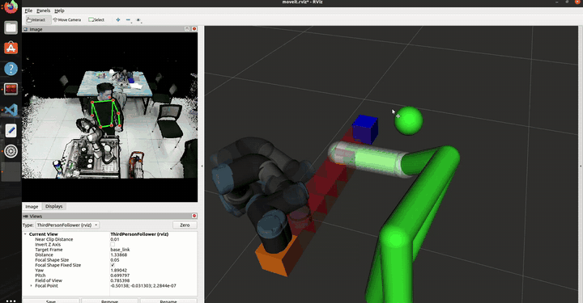
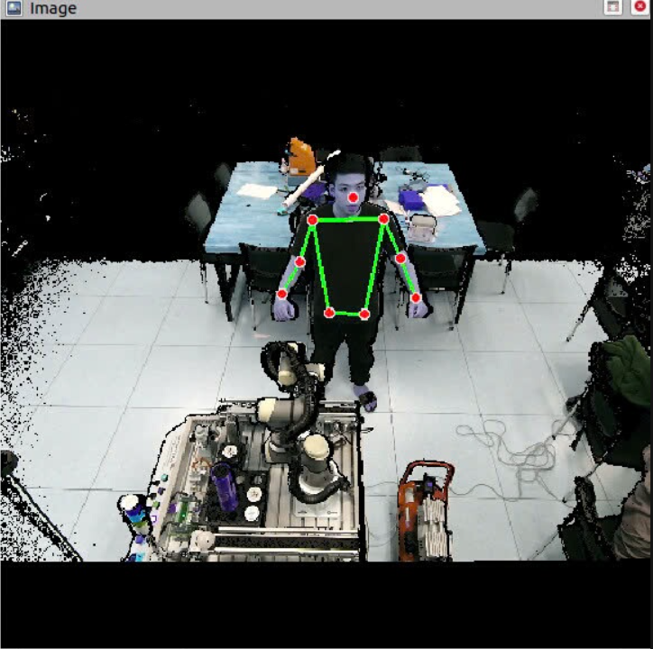
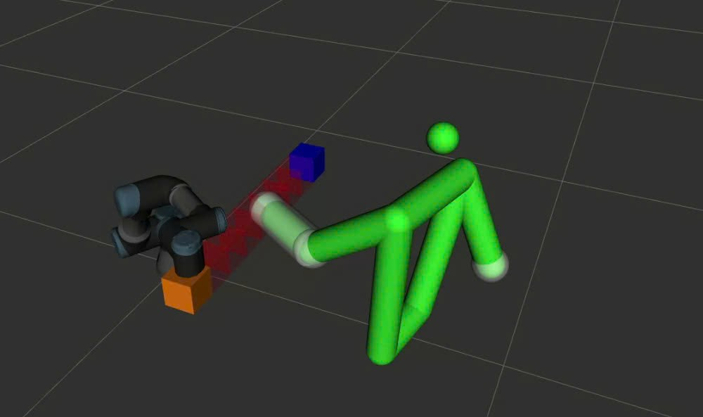
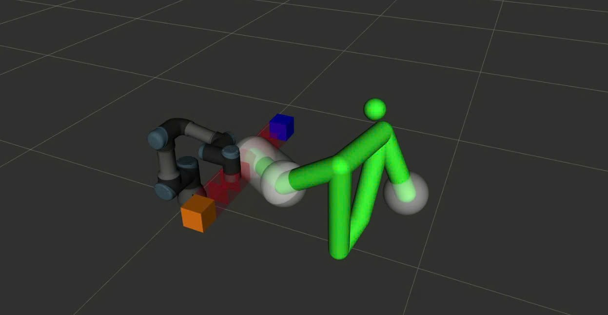

# Cộng tác người – robot UR3: Tránh vật cản động với vùng đệm an toàn thích ứng theo vận tốc

Đồ án tốt nghiệp Cử nhân – Ngành Cơ điện tử, Đại học Bách khoa Hà Nội (HUST).
Đề tài: *"Nghiên cứu tương tác giữa người và Rô bốt cộng tác"*, hoàn thành tháng 2/2026.

Robot cộng tác UR3 quan sát con người bằng camera Kinect v2, mô hình hóa cơ thể người thành các vật cản trong môi trường lập kế hoạch, và tái lập kế hoạch đường đi theo thời gian thực bằng thuật toán **D\* Lite** để tiếp tục làm việc mà không va chạm với người. **Vùng đệm an toàn quanh tay người tự giãn hoặc co theo vận tốc tương đối** giữa robot và con người. Hệ thống được kiểm thử trên mô phỏng (ROS / RViz / MoveIt) và trên **robot UR3 thật** tại Phòng thí nghiệm Nhà máy số thông minh, HUST.

## Demo

<p align="center"></p>
<p align="center"><i>Bên trái: ảnh Kinect v2 với khung xương MediaPipe. Bên phải: RViz/MoveIt với mô hình người (xanh lá), vùng đệm quanh tay và đường đi D* Lite (ô đỏ) từ điểm đầu đến điểm đích. Video tăng tốc 2 lần.</i></p>

## Điểm nổi bật

- **Vùng đệm an toàn thích ứng theo vận tốc**: vùng bảo vệ quanh tay người thay đổi tuyến tính theo vận tốc tương đối giữa robot và người. Robot chạy nhanh thì vùng đệm lớn, robot chậm lại thì vùng đệm thu nhỏ, giúp vừa an toàn vừa tránh dừng không cần thiết. Vận tốc và hệ số phình được lọc mượt để hạn chế nhiễu cảm biến gây tái lập kế hoạch liên tục.
- **So sánh thuật toán tìm đường**: A\*, LPA\*, D\* và D\* Lite được so sánh trên lưới 50×50, 100×100 và 200×200 theo thời gian tính toán và mức sử dụng CPU. D\* Lite được chọn vì phù hợp với bài toán tái lập kế hoạch gia tăng khi môi trường thay đổi.
- **Mô hình hóa con người thành vật cản**: các khớp xương từ MediaPipe kết hợp độ sâu Kinect được chuyển thành hình cầu và hình trụ trong planning scene của MoveIt.
- **Đánh giá định lượng**: đo thời gian tính toán quỹ đạo và thời gian thực thi trên robot thật với 4 kịch bản.

## Sơ đồ hệ thống

```
Kinect v2 (ảnh màu + độ sâu)
      │
      ▼
MediaPipe Pose ──► Khung xương 3D (hệ camera) ──► TF: kinect_link → base_link
      │
      ▼
Vật cản hình người + vùng đệm an toàn theo vận tốc ──► Planning scene MoveIt
      │
      ▼
D* Lite tái lập kế hoạch trên lưới ──► waypoint ──► Quỹ đạo MoveIt (retime) ──► UR3
```

### Nhận diện con người

Ảnh màu từ Kinect v2 được đưa qua MediaPipe Pose để lấy các khớp vai, khuỷu tay, cổ tay, hông, sau đó kết hợp ảnh độ sâu để tính tọa độ 3D.

<p align="center"></p>

### Vùng đệm an toàn theo vận tốc

Con người được biểu diễn trong RViz/MoveIt bằng các hình trụ và hình cầu (màu xanh). Vùng đệm trong suốt quanh tay người thay đổi theo vận tốc của robot:

| Robot đang di chuyển | Robot tiến gần tay người, vùng đệm mở rộng |
|---|---|
|  |  |

## Kết quả trên robot UR3 thật

Thời gian thực hiện một chu trình di chuyển, trung bình 10 lần đo (`results/1.py`):

| Kịch bản | Thời gian trung bình |
|---|---|
| Không có người | ~3,06 s |
| Có người ở gần vùng làm việc | ~3,06 s |
| Người chặn đường đi ở vị trí cố định | ~10,1 s |
| Người chặn đường đi ở vị trí di động | ~15,4 s |

Khi người chỉ đứng gần mà không cản đường, robot giữ nguyên thời gian chu trình. Khi bị chặn, robot tái lập kế hoạch và đi vòng tránh người.

## Cấu trúc thư mục

```
skeleton_marker4/scripts/
├── skeleton_tracker.py     # node chính: Kinect + MediaPipe, TF, vật cản hình người, vùng đệm an toàn
├── data_skeleton.py        # khởi tạo camera, tọa độ khung xương 3D, marker và vật cản va chạm
├── Dstar_Lite.py           # thuật toán tìm đường D* Lite
├── robot_controller.py     # điều khiển chuyển động UR3 qua MoveIt
├── kinect_depth_viewer.py  # kiểm tra độ sâu Kinect: ảnh độ sâu tô màu + khoảng cách tại tâm ảnh
└── kinect_pose_overlay.py  # kiểm tra MediaPipe: vẽ khung xương cơ bản lên ảnh màu Kinect
images/                     # ảnh minh họa dùng trong README (trích từ báo cáo đồ án)
results/
├── *_tongtg.csv, *_tongthuattoan.csv   # số liệu đo thời gian thực thi và thời gian tính toán
└── 1.py, 2.py, 3.py                    # script vẽ biểu đồ kết quả trong báo cáo
```

## Công nghệ sử dụng

ROS Noetic · Ubuntu 20.04 · Python 3.8 · MoveIt · RViz · MediaPipe · OpenCV · libfreenect2 (Kinect v2) · Universal_Robots_ROS_Driver · UR3 (CB-Series)

## Cách chạy

Cần một catkin workspace đã cài `universal_robot`, `Universal_Robots_ROS_Driver` và `libfreenect2` / `pylibfreenect2`.

```bash
# 1. Khởi động driver UR3 và MoveIt
roslaunch ur_robot_driver ur3_bringup.launch robot_ip:=<IP_ROBOT>
roslaunch ur3_moveit_config moveit_planning_execution.launch
roslaunch ur3_moveit_config moveit_rviz.launch

# 2. Chạy theo dõi khung xương và bộ điều khiển tránh va chạm
rosrun skeleton_marker4 skeleton_tracker.py
rosrun skeleton_marker4 robot_controller.py
```

## Hạn chế

- **Chỉ dùng một camera Kinect v2**: khi cánh tay robot che khuất tay người, hoặc người đứng ở góc mà MediaPipe không nhận diện được khung xương, hệ thống mất vị trí người và robot **không tránh được** trong khoảng thời gian đó. Hướng khắc phục là dùng nhiều camera ở các góc khác nhau và hợp nhất dữ liệu.
- Vùng đệm an toàn thay đổi tuyến tính theo vận tốc, chưa dự đoán trước hướng di chuyển của người.
- Thử nghiệm trong phòng thí nghiệm với một người; chưa đánh giá khi có nhiều người hoặc nhiều vật cản cùng lúc.

## Lời cảm ơn

Giảng viên hướng dẫn: TS. Đoàn Thanh Xuân, Khoa Cơ điện tử, Trường Cơ khí, HUST.
Hệ thống nền (theo dõi khung xương, D\* Lite, điều khiển UR3) được phát triển tiếp từ
[leminhduc-601/UR3-Dynamic-Obstacle-Avoidance](https://github.com/leminhduc-601/UR3-Dynamic-Obstacle-Avoidance).

## Tác giả

Vũ Thành Đức – [github.com/milkywayvtd](https://github.com/milkywayvtd)
